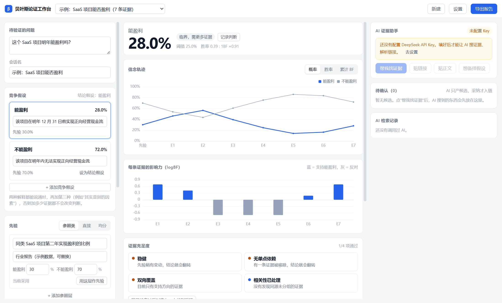
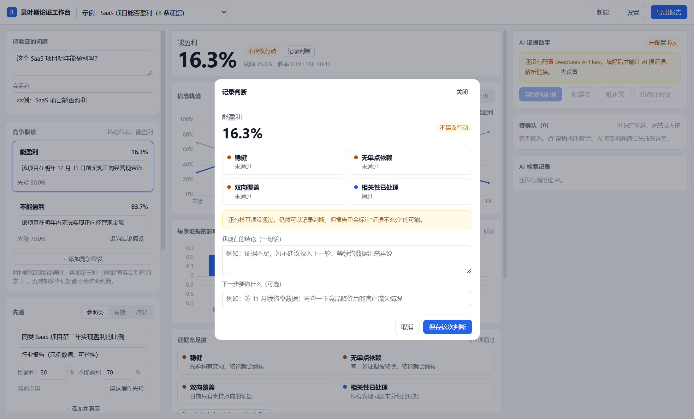
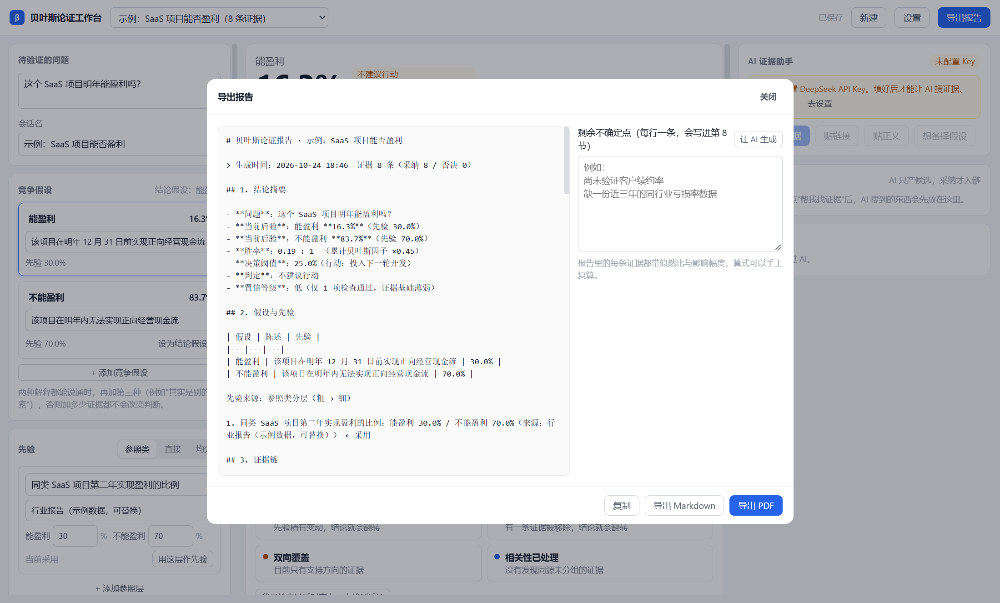

# 贝叶斯论证工作台

把"我更相信 A 而不是 B"这种模糊判断，拆成**假设 + 证据 + 似然比**，算出后验概率，并导出可复核的报告。

桌面应用（Electron + React + TypeScript），数据全部留在本地。可选接入 DeepSeek 帮你**找候选证据**——但 AI 只产候选，必须人工逐条采纳，且每条都要求引文可溯源。

> 它不是"让 AI 告诉你答案"的工具，而是"让你把自己的判断过程摊开来检查"的工具。



## 功能

**贝叶斯内核**
- log-odds 计算、多假设归一、五档似然比（很不可能 → 很可能）
- 证据相关性折扣（同源证据不会当成互相独立的两次冲击）
- 边界处理、逐条回放（哪条证据把概率推了多少）
- 先验参照类分层：从粗到细的基准率，避免凭空拍先验

**分析与检查**
- 概率 / 胜率 / 累计 BF 轨迹图，逐条证据 logBF 图
- 敏感性分析：留一法（去掉某条证据会怎样）、先验 ±10/±20 点、翻转结论还需要多少反证
- 证据充足度四灯
- 决策阈值：把成本与损失折成"该行动的概率门槛"

**落地**
- 证据链增删改、采纳 / 否决、编辑即重算
- 判断记录：快照 + 结论 + 下一步
- 导出 Markdown / PDF 报告
- 会话导入导出、本地自动保存与备份

**AI 辅助（可选）**
- 找候选证据、解析链接、解析正文、提出备择假设、指出剩余不确定点
- 候选择优：AI 产候选 → 人工采纳 → 引文溯源校验，三步都过才进证据链

| 记录判断 | 导出报告 |
|---|---|
|  |  |

## 快速开始

需要 Node.js **20+**。

```bash
npm ci            # 按锁文件安装，保证可复现
npm run dev       # 起开发环境（vite 5178 + electron）
npm test          # 领域层单测（vitest）
npm run typecheck # TS 类型检查
npm run dist      # 打包免安装单文件 exe（输出到 release/）
```

打包时 Electron 二进制走镜像：`ELECTRON_MIRROR=https://npmmirror.com/mirrors/electron/`

Windows 用户也可以直接下载 [Releases](../../releases) 里的 exe，不需要装 Node。

## AI 功能的 Key

程序**不自带**任何 Key。要用 AI 功能，在「设置」里填自己的 DeepSeek API Key：

- Key 经 Electron `safeStorage` 加密后落盘（带 `enc:` 前缀），不写明文、不进仓库
- 不填 Key 时，除 AI 以外的功能全部可用
- 第三方 API 的用量与费用由使用者自行承担，并需遵守对应服务的条款

## 数据在哪

```
%APPDATA%\贝叶斯论证工作台\data\      # Windows
~/Library/Application Support/贝叶斯论证工作台/data/   # macOS
```

卸载默认保留数据。会话可导出成 JSON 自行备份。

## 结构

```
electron/          主进程：窗口、IPC、本地存储、Key 加密、AI 请求
  ├─ main.js       创建窗口；ELECTRON_START_URL 指向 dev server
  ├─ ipc.js        主进程 IPC 注册
  ├─ ai-ipc.js     AI 相关请求（在主进程发，避免渲染进程碰 Key）
  └─ secrets.js    safeStorage 加解密
src/domain/        纯函数领域层，无 UI、无 IO，全部可单测
  ├─ bayes.ts      log-odds 与后验
  ├─ replay.ts     逐条回放
  ├─ sensitivity.ts 留一法 / 先验扰动 / 翻转距离
  ├─ sufficiency.ts 证据充足度
  ├─ tiers.ts      参照类分层
  └─ report.ts     报告渲染
src/ui/            React 组件（左：假设与先验；中：证据链与图表；右：AI 与检查）
tests/             vitest 单测（领域层）
tools/             开发期脚本：CDP 冒烟、导出校验、图标生成
docs/             设计规格与使用说明
```

领域层刻意与 UI 解耦：`src/domain/**` 不 import React、不碰文件系统，所以分析和测试可以脱离界面跑。

## 已知限制

1. **似然值是主观估计**，输出的是"信念量化"，不是客观概率。
2. **证据独立性只是近似**，同源证据靠分组折扣缓解，不是严格处理。
3. 存在折扣时，单条证据的"影响幅度"与顺序有关（**最终后验不受影响**）。
4. AI 需要自备 Key；没配 Key 时 AI 功能不可用。
5. 本版没有：账号体系、云同步、多人协作、定时自动抓取。

## 许可

[MIT](LICENSE)
